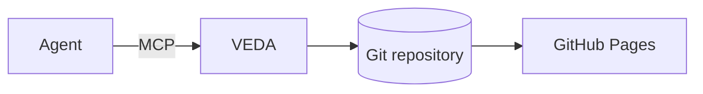
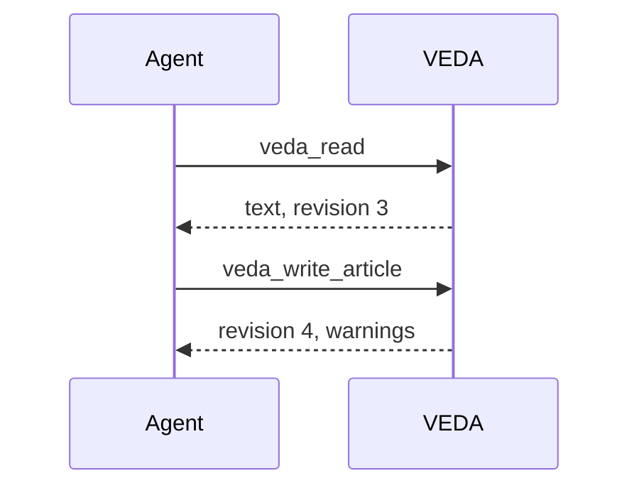

# Formatting

Everything on this page renders the same in VEDA, on GitHub and on the
published site. Anything else is removed or shown as plain text, and VEDA
warns about it when the page is written.

## Text

Paragraphs, **bold**, *italic*, ~~strikethrough~~, `inline code`, links such
as [Writing pages](writing.md) and bare URLs like https://example.com.
Keys: <kbd>Ctrl</kbd>+<kbd>K</kbd>. Formulas in text: H<sub>2</sub>O, x<sup>2</sup>.

- Lists
  - nested lists
- [x] task done
- [ ] task open

| Service | Port | Notes |
| --- | ---: | --- |
| web | 443 | behind the proxy |
| api | 8080 | loopback only |

## Alerts

> [!NOTE]
> Background that helps.

> [!TIP]
> A better way to do it.

> [!IMPORTANT]
> Required to succeed.

> [!WARNING]
> Needs attention: restart only after the backup finishes.

> [!CAUTION]
> Risky: this deletes data.

## Collapsible blocks

<details>
<summary>Full configuration</summary>

```yaml
server:
  listen: 443
  upstream: http://127.0.0.1:8080
```

</details>

<details open>
<summary>Shown expanded</summary>

Use `open` for details most readers need.

</details>

## Code

```bash
systemctl restart example && curl -fsS http://127.0.0.1:8080/health
```

```go
func main() {
	fmt.Println("hello")
}
```

## Diagrams





## Footnotes and definitions

A fact with its source.[^source]

Front matter
: The optional `---` block at the top of this page; VEDA hides it and uses its
  `title:`.

[^source]: Sources and asides go in footnotes.
